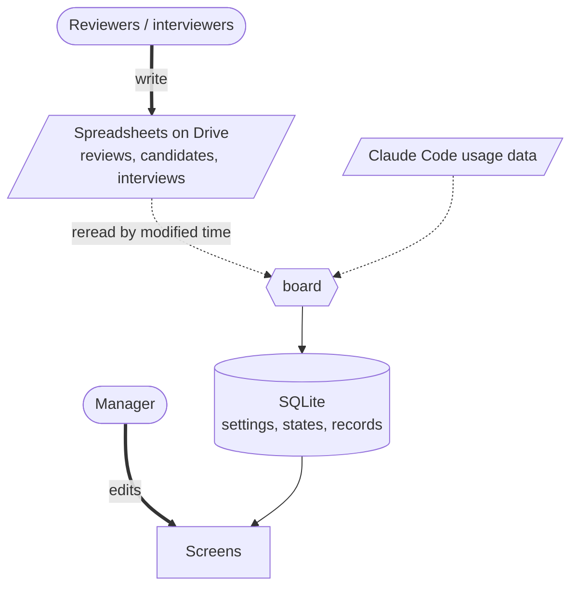

[🇯🇵 日本語](README.md) | [🇬🇧 English](README.en.md)

# mgmt-kit

[](https://github.com/yktsnet/mgmt-kit/actions/workflows/board.yml)

board is a web app for teams building with AI agents that runs hiring, growth and reviews on one set of criteria, the five-axis, five-level ladder.
Reviewers only write verdicts and evidence in a spreadsheet; board decides the levels and shows each role only what it should see.

Documents linked from this page are in Japanese unless noted.

## Screens

| | |
|---|---|
| **Review**<br> | **Now**<br> |
| Levels for each axis and for the person follow from the verdicts and evidence on each item. The reviewer submits and the manager approves. Items on axis B show skill counts from Claude Code usage data | Between reviews, pick the one axis each person raises next. Claude Code usage is shown next to the team average |
| **Hiring**<br> | **Settings**<br> |
| Interviews judge the same items as for current members. Axes below what the opening requires are shown in red. The selection stage advances here | Set the items and version of the 5×5 definition, each member's reviewer and roles, and the openings. A version already used by a review or interview cannot be edited; create a new version instead |

## Why

Once a team builds with AI agents, differences between people also show in whether they run the distributed workflows and how they use AI. But when everyone's output takes a different shape, you cannot tell a difference in substance from a difference in format. Run hiring, growth and reviews as separate systems and each has its own scale, and people end up reconciling the gaps between them forever.

So mgmt-kit judges all three on one set of criteria. What gets read is the standardized output that comes from running the distributed workflows, and the record of running them.

- **Decide the axes.** Once you know what to measure, you know what standardization has to align
- **Distribute the workflows.** When a team runs standardized procedures, its output takes the same shape
- **Make the output visible.** Output of the same shape can be read for differences in substance, not format
- **Evaluate.** Only once there is something to read can you judge what level a person is at
- **Measure members and candidates on one scale.** The axes are shared; only the evidence changes

The point is that these five are connected. Build only the axes and there is nothing to measure. Build only the standardization and nobody can tell whether it is working. Hire on a separate standard and the scale no longer fits once you start growing the people you hired.

The axes come before the workflows. Standardize first and alignment stops at format. Each verdict maps one-to-one to a place in the workflows; if a verdict points somewhere the workflows do not have, one of them is wrong. Distributing the workflows is the job of [sdlc-kit](https://github.com/yktsnet/sdlc-kit).

Reviewers do not have to learn a new tool. Non-engineers write in the spreadsheets they already use; connecting them is engineering's job.

## Quick Start

```bash
git clone https://github.com/yktsnet/mgmt-kit.git
cd mgmt-kit/board
docker compose up
```

Open http://localhost:8000. With no configuration, it starts in demo mode on the ten fictional members and candidates in `board/samples/`; pick a member on the login screen. Settings, review states and records live in a volume, so they survive `docker compose down` and `up`.

To sign in with real Google accounts and read sheets from Drive, follow [board/docs/setup.md](board/docs/setup.md).

## How it works



The sheets are input written by people, and board reads them as a copy. The definition and its versions, members and roles, openings, and the states and records of reviews and hiring live only in board's SQLite and are never duplicated in the sheets. The sheet format is in [board/docs/sheets.md](board/docs/sheets.md).

### Inputs

| Input | How board uses it | Location |
|---|---|---|
| ladder | Five axes, five levels and a verdict text for each cell. It becomes the first version of board's definition, which is then refined in board's settings | `ladder/` |
| usage | Claude Code usage data. Adds skill counts to the items of axis B (running the distributed workflows) and shows usage on the Now tab | `usage/` |

usage adds three views to a review. Standardization is counted by skill runs and names, and the amount of work by issues, PRs, commits and lines. For the amount of input, look at the absolute amount first, and at how efficiently it is used once there is enough. What it looks like when all three are in place, and what to do for each way it breaks down, is in [the target state](usage/tools/usage/claude-code/README.md#あるべき姿).

### Roles

| Role | Tabs | Scope |
|---|---|---|
| Manager | Review, Now, Hiring, Settings | Everything. Can approve reviews |
| Reviewer (a member with assignees) | Review, Now | Reviews and records of their assignees. Their own review only once approved |
| Member with Hiring | Now, Hiring | All of hiring |
| Member | Now | Their own row and the team average |

Roles can overlap. The rules for what each role sees, and why, are under "見せる範囲" in [board/docs/decisions.md](board/docs/decisions.md).

## Without board

You can also bring in just the ladder and the usage reports, without board.

**Scoring skill**: copy it, together with `docs/`, into the repository that holds the work of the person being scored. A score is the five axis scores, the level and the one axis to raise next, and it is not written to a file by default. Whoever decides to keep scores decides first where they go and how real names are handled.

```bash
git clone https://github.com/yktsnet/mgmt-kit.git
cp mgmt-kit/ladder/docs/{ladder,scoring,hiring,adapt}.md ~/repos/target/docs/
cp -r mgmt-kit/ladder/.claude/skills/ladder-score ~/repos/target/.claude/skills/
```

**Usage reports**: lays out Claude Code usage per member every day, and also counts the organization's GitHub Actions minutes. `usage/` mirrors the layout of the repository it goes into, so copy it into a repository for management and delete the sample data and roster.

```bash
cp -R mgmt-kit/usage/. <management-repo>/
cd <management-repo>/tools/usage
rm -rf claude-code/{data,members,charts} github-actions/{data,charts} claude-code/github.json
```

Then follow "導入の手順" (setup) in the copied [tools/usage/README.md](usage/tools/usage/README.md) and change the values listed under "組織に合わせて替える値".

## Scope

- usage assumes a team that works through GitHub issues and PRs and uses Claude Code. Work done on GitLab or with other agents cannot be evaluated
- Candidates have no usage data, so usage applies only to current members
- All people, repositories and data in the samples are fictional. `scripts/sample-usage.py` generates the dummy usage data, then each report's `render.py` rebuilds its tables and charts

## Docs

| Document | Contents |
|---|---|
| [ladder/docs/ladder.md](ladder/docs/ladder.md) | Five axes, five levels, the verdict text for each cell, and what to read when judging. How the source of truth is split is in ladder/README.md |
| [ladder/docs/personas.md](ladder/docs/personas.md) | Reference personas for each level |
| [ladder/docs/scoring.md](ladder/docs/scoring.md) | Scoring a member and choosing the next axis to raise |
| [ladder/docs/hiring.md](ladder/docs/hiring.md) | Applying the same axes to candidates |
| [ladder/docs/adapt.md](ladder/docs/adapt.md) | What to replace when bringing it into your company |
| [ladder/docs/ref/sources.md](ladder/docs/ref/sources.md) | The public ladders it builds on, and their licenses |
| [ladder/README.md](ladder/README.md) | Slides that give the whole ladder at a glance |
| [board/README.md](board/README.md) | Entry point for people changing board |
| [training/README.md](training/README.md) | A proposal for AI study sessions for engineers placed at client sites |

## License

MIT
