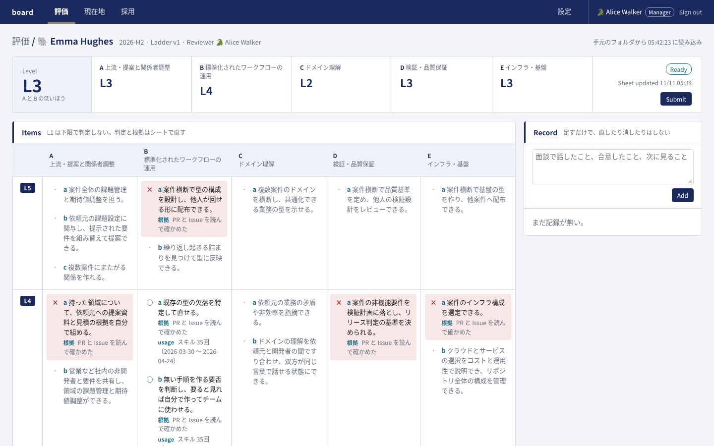
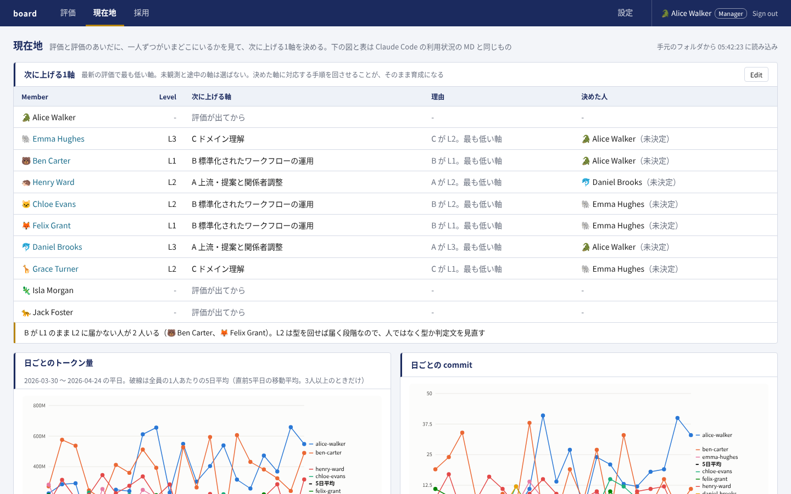
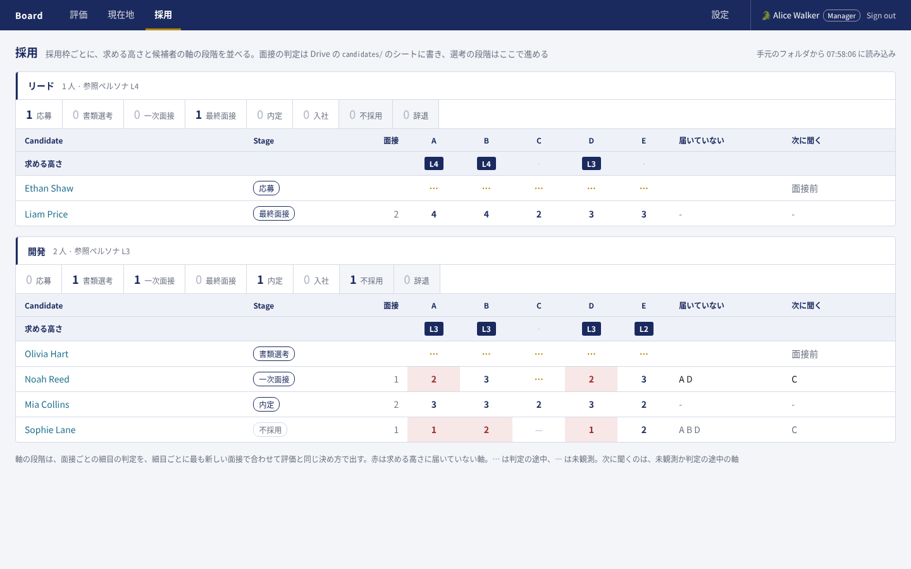
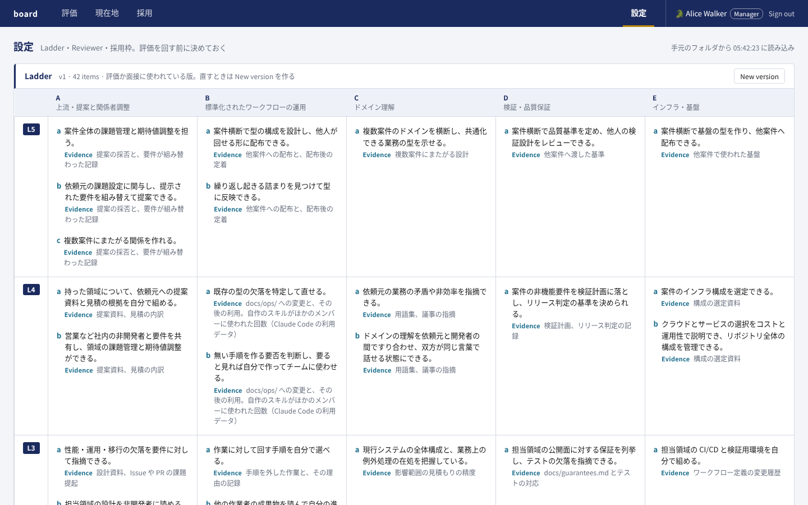
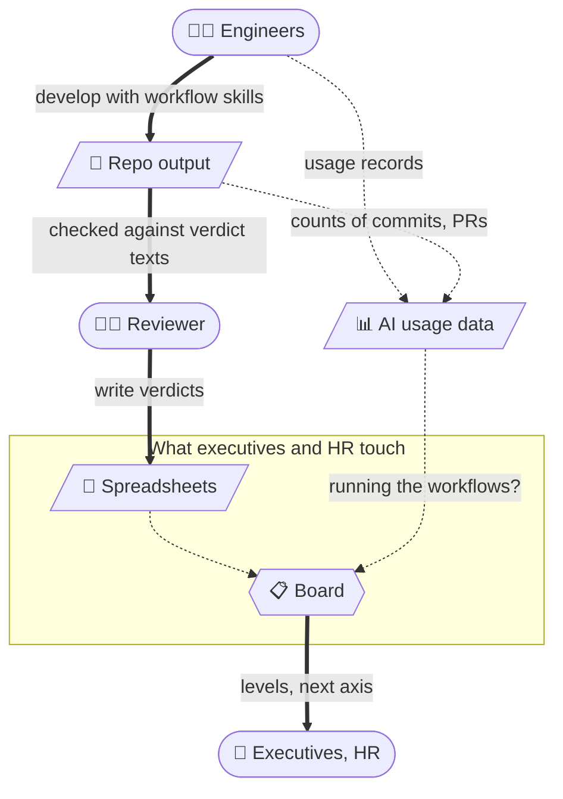

[🇯🇵 日本語](README.md) | [🇬🇧 English](README.en.md)

# mgmt-kit

[](https://github.com/yktsnet/mgmt-kit/actions/workflows/board.yml)

This repository connects the work of teams building with AI agents to the people who evaluate it but are not engineers, so hiring, growth and reviews are decided on one set of criteria.
At its center is the web app Board; verdicts only need to be written in a familiar spreadsheet.

Documents linked from this page are in Japanese unless noted.

## Screens

| | |
|---|---|
| **Review**<br> | **Now**<br> |
| Levels for each axis and for the person follow from the verdicts and evidence on each item. The reviewer submits and the manager approves. Items on axis B show skill counts from Claude Code usage data | Between reviews, pick the one axis each person raises next. Claude Code usage is shown next to the team average |
| **Hiring**<br> | **Settings**<br> |
| Interviews judge the same items as for current members. Axes below what the opening requires are shown in red. The selection stage advances here | Set the items and version of the 5×5 definition, each member's reviewer and roles, and the openings. A version already used by a review or interview cannot be edited; create a new version instead |

## Why

Hiring, growth and reviews are often decided by people who are not engineers, such as executives and HR. But engineers' work shows up in repository output and in how they use AI, which those people find hard to read. Decide without being able to read it, and the criteria vary with whoever is looking, and hiring, growth and reviews each run on their own scale. People end up reconciling the gaps between them forever.

So mgmt-kit connects executives and HR with engineers' work.

- **Leave how executives and HR work alone.** Verdicts and interview notes only need to be written in the spreadsheets people already use. Board reads them and turns them into levels, and setting up and running Board is the engineers' job
- **Make the work readable on one set of criteria.** Distribute workflows (standardized development procedures) so output takes the same shape, and judge hiring, growth and reviews on ladder, a five-axis, five-level set of criteria

One set of criteria only works when these five are connected.

- **Decide the axes.** Once you know what to measure, you know what standardization has to align
- **Distribute the workflows.** When a team runs standardized procedures, its output takes the same shape
- **Make the output visible.** Output of the same shape can be read for differences in substance, not format
- **Evaluate.** Only once there is something to read can you judge what level a person is at
- **Measure members and candidates on one scale.** The axes are shared; only the evidence changes

Build only the axes and there is nothing to measure. Build only the standardization and nobody can tell whether it is working. Hire on a separate standard and the scale no longer fits once you start growing the people you hired.

The axes come before the workflows. Standardize without deciding what to measure, and only the file format gets aligned; the substance a review needs never shows up in the output. Distributing the workflows is the job of [sdlc-kit](https://github.com/yktsnet/sdlc-kit).

## Quick Start

```bash
git clone https://github.com/yktsnet/mgmt-kit.git
cd mgmt-kit/board
docker compose up
```

Open http://localhost:8000. With no configuration, it starts in demo mode on the ten fictional members and candidates in `board/samples/`; pick a member on the login screen. Settings, review states and records live in a volume, so they survive `docker compose down` and `up`.

To use it for real, in a company or similar, with Google sign-in and sheets read from Drive, configure Board with environment variables. They come in three groups: sign-in (`BOARD_GOOGLE_CLIENT_ID`, `BOARD_ALLOWED_DOMAIN`, `BOARD_MANAGERS`, `BOARD_SESSION_KEY`), reading the sheets (`BOARD_SOURCE`, `BOARD_DRIVE_FOLDER_ID`, `BOARD_SERVICE_ACCOUNT_KEY`, `BOARD_SYNC_INTERVAL`) and usage data (`BOARD_USAGE_DIR`). What each value means, and the setup steps, are in [board/docs/setup.md](board/docs/setup.md); the layout of the sheets on Drive is in [board/docs/sheets.md](board/docs/sheets.md).

## How it works



Thick lines are people's actions; dotted lines are what usage and Board collect and read automatically.


Running the workflows leaves the work in output and in usage data, and each is evidence for a different judgment.

- **Output sets the level.** The workflows align the shape and location of output, and each ladder verdict text is written so it says what to open in the repository to check whether it holds. Reviewers open the place a verdict points to, judge it, and write the verdict with its evidence in the sheet. Candidates have no output, so interviewers apply the same verdict texts to what they hear in interviews
- **Usage data shows whether people develop the way the workflows prescribe.** usage collects, per member and every day, how Claude Code is used (tokens, skills, subagents) and the amount of work on GitHub (commits, PRs, issues, lines), so you can compare whether work matching the amount used comes out as issues and PRs. What to look at and how to tell what is missing is in [the target state](usage/tools/usage/claude-code/README.md#あるべき姿)

Executives and HR only touch the sheets and Board's screens. Verdicts are written in the sheets, so reviewers and interviewers do not need to be engineers either. People decide whether to hire and which axis to raise next; Board lays out what they need to decide. Sheets are only read as a copy; the definition, members and roles, openings, and the states of reviews and hiring live only in Board.

### Inputs

| Input | How Board uses it | Location |
|---|---|---|
| ladder | Five axes, five levels and a verdict text for each cell. It becomes the first version of Board's definition, which is then refined in Board's settings | `ladder/` |
| usage | Claude Code usage data and the amount of work on GitHub. Adds counts of the workflow skills to the review of axis B (running AI development workflows) and shows usage on the Now tab | `usage/` |

### Roles

| Role | Tabs | Scope |
|---|---|---|
| Manager | Review, Now, Hiring, Settings | Everything. Can approve reviews |
| Reviewer (a member with assignees) | Review, Now | Reviews and records of their assignees. Their own review only once approved |
| Member with Hiring | Now, Hiring | All of hiring |
| Member | Now | Their own row and the team average |

Roles can overlap. The rules for what each role sees, and why, are under "見せる範囲" in [board/docs/decisions.md](board/docs/decisions.md).

## Tech Stack

| Layer | Technology | Reason |
|---|---|---|
| Screens and API | FastAPI with Jinja2 HTML | No frontend build; everything can be changed in Python |
| Input | Google Sheets (Sheets API); the demo reads local `.xlsx` (openpyxl) | Deciders only write in a familiar sheet. Production and the demo read it the same way |
| Storage | SQLite (a Docker volume) | The definition, members, states and records live only in Board and are never duplicated in the sheets |
| Sign-in | Sign in with Google (google-auth) | No passwords to keep; who can get in is decided on the Workspace side |
| Usage data | usage's daily JSON | Reads the daily tally as is and adds it to the evidence |
| Run | Docker Compose | `docker compose up` alone starts the demo |

## Design Decisions

- **Input is Google Sheets, not Excel**: `.xlsx` files on Drive run into compatibility mode and sync conflicts. The job is entering values and simple tallies, so nothing only Excel has is needed
- **Sheets are read as a copy; Board holds the values everything rests on**: keeping the definition or assignments in both places leaves you unsure which is right
- **The definition is versioned, and a version used by a review or interview cannot be edited**: the premises of past verdicts must not change afterwards
- **Candidates are judged on the same items as members**: so both line up on one scale. Candidates have no usage data, so it is not shown in hiring
- **What each role sees is narrowed by one rule**: narrowing the list, the person page, Now and the API separately lets something leak somewhere
- **Usage data alone never sets a score**: it only shows how things stand between reviews

The full list of decisions, and what is out of scope, is in [board/docs/decisions.md](board/docs/decisions.md) (Japanese).

## Without Board

You can also bring in just the ladder and the usage reports, without Board.

**Scoring skill**: copy it, together with `docs/`, into the repository that holds the work of the person being scored. A score is the five axis scores, the level and the one axis to raise next, and it is not written to a file by default. Whoever decides to keep scores decides first where they go and how real names are handled.

```bash
git clone https://github.com/yktsnet/mgmt-kit.git
cp mgmt-kit/ladder/docs/{ladder,scoring,hiring,adapt}.md ~/repos/target/docs/
cp -r mgmt-kit/ladder/.claude/skills/ladder-score ~/repos/target/.claude/skills/
```

**Usage reports**: lays out Claude Code usage per member every day, and also counts the organization's GitHub Actions minutes. `usage/` mirrors the layout of the repository it goes into, so copy it into a repository for management and delete the sample data and roster.

```bash
cp -R mgmt-kit/usage/. <management-repo>/
cd <management-repo>/tools/usage
rm -rf claude-code/{data,members,charts} github-actions/{data,charts} claude-code/github.json
```

Then follow "導入の手順" (setup) in the copied [tools/usage/README.md](usage/tools/usage/README.md) and change the values listed under "組織に合わせて替える値".

## Scope

- usage assumes a team that works through GitHub issues and PRs and uses Claude Code. Work done on GitLab or with other agents cannot be evaluated
- Candidates have no usage data, so usage applies only to current members
- What Board promises, and the tests that hold it to those promises, is in [the guarantee ledger](docs/guarantees/README.md) (Japanese). Behavior not listed there may change without notice
- All people, repositories and data in the samples are fictional. `scripts/sample-usage.py` generates the dummy usage data, then each report's `render.py` rebuilds its tables and charts

## Docs

| Document | Contents |
|---|---|
| [ladder/docs/ladder.md](ladder/docs/ladder.md) | Five axes, five levels, the verdict text for each cell, and what to read when judging. How the source of truth is split is in ladder/README.md |
| [ladder/docs/personas.md](ladder/docs/personas.md) | Reference personas for each level |
| [ladder/docs/scoring.md](ladder/docs/scoring.md) | Scoring a member and choosing the next axis to raise |
| [ladder/docs/hiring.md](ladder/docs/hiring.md) | Applying the same axes to candidates |
| [ladder/docs/adapt.md](ladder/docs/adapt.md) | What to replace when bringing it into your company |
| [ladder/docs/ref/sources.md](ladder/docs/ref/sources.md) | The public ladders it builds on, and their licenses |
| [ladder/README.md](ladder/README.md) | Slides that give the whole ladder at a glance |
| [usage/tools/usage/claude-code/README.md](usage/tools/usage/claude-code/README.md) | The Claude Code usage tables, and the target state |
| [board/README.md](board/README.md) | Entry point for people changing Board |
| [training/README.md](training/README.md) | A proposal for AI study sessions for engineers placed at client sites |

## License

MIT
