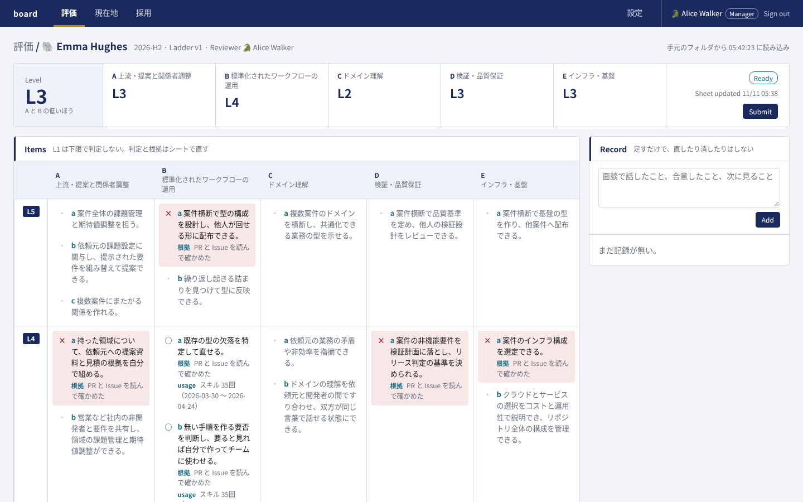
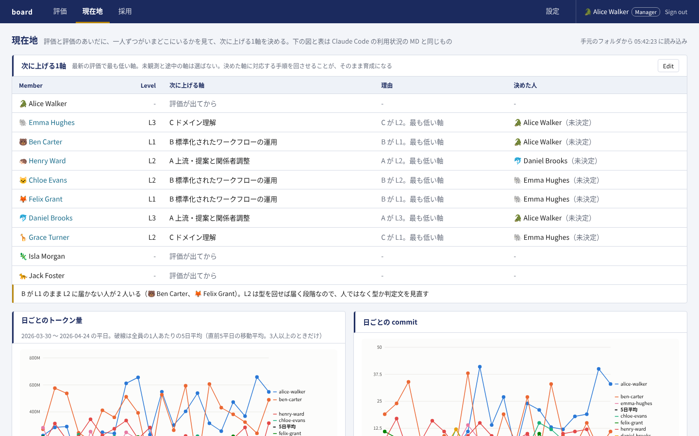
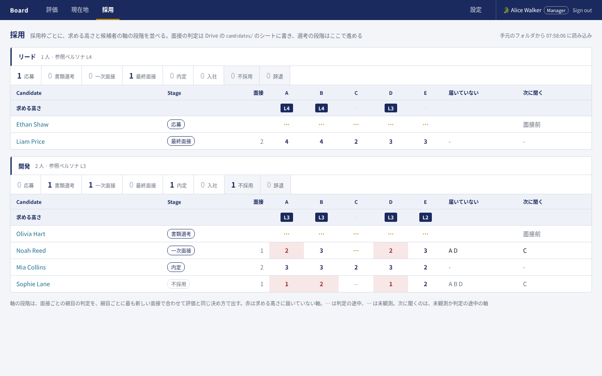
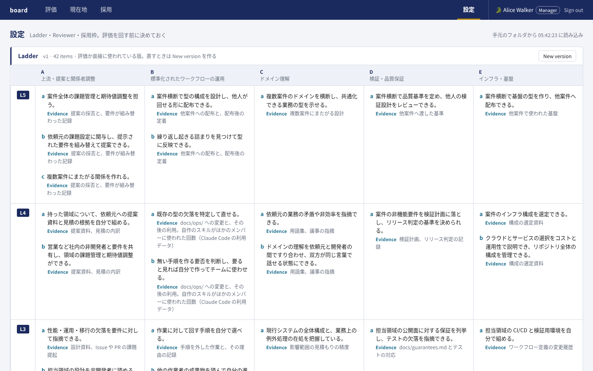
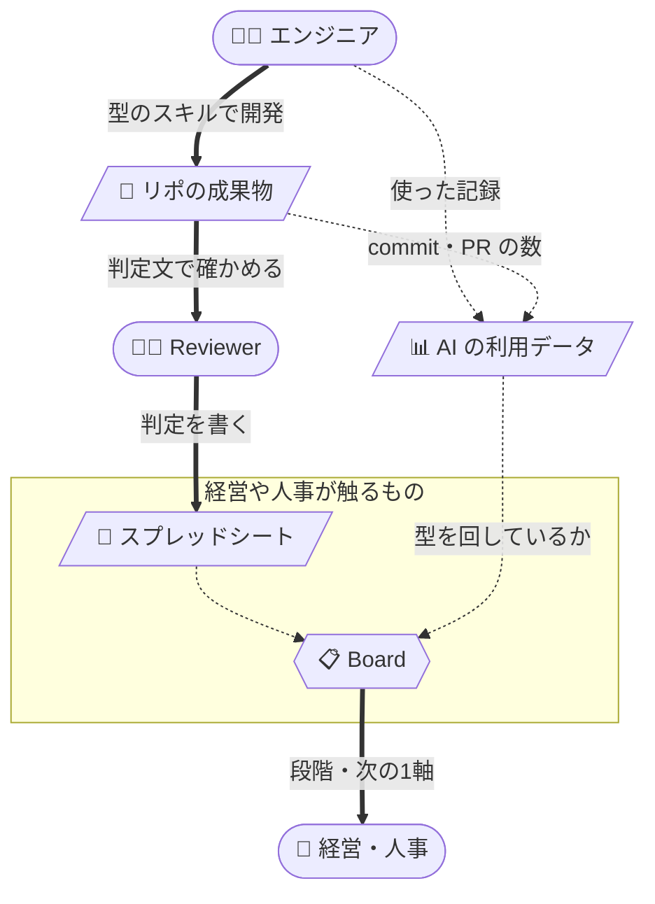

[🇯🇵 日本語](README.md) | [🇬🇧 English](README.en.md)

# mgmt-kit

[](https://github.com/yktsnet/mgmt-kit/actions/workflows/board.yml)

このリポは、AI エージェントで開発するチームの仕事と、それを評価するエンジニアでない人をつなぎ、採用・育成・評価を同じ評価基準で決められるようにする。
中心はウェブアプリ Board で、判定は使い慣れたスプレッドシートに書くだけでよい。

## Screens

| | |
|---|---|
| **評価**<br> | **現在地**<br> |
| 細目ごとの判定と根拠から、軸の段階と本人の段階を決める。Reviewer が Submit し、Manager が Approve する。B の細目には、Claude Code の利用データにあるスキルの回数を添える | 評価と評価のあいだに、一人ずつの次に上げる1軸を決める。Claude Code の利用状況を、全員の平均と並べて見る |
| **採用**<br> | **設定**<br> |
| 在籍者と同じ細目を面接で判定し、採用枠の求める高さに届いていない軸を赤で出す。選考の段階はここで進める | 5×5 の定義の細目と版、在籍者の Reviewer と役割、採用枠を決める。評価か面接が使った版は直せず、New version を作る |

## Why

採用・育成・評価を決めるのは、経営や人事など、エンジニアでない人であることも多い。ところがエンジニアの仕事はリポジトリの成果物と AI の使い方に出ていて、その人たちからは読みにくい。読めないまま決めると、基準は見る人ごとにぶれ、採用・育成・評価がそれぞれ別の尺度で回る。制度の間の食い違いは、人が調整し続けることになる。

そこで mgmt-kit は、経営や人事とエンジニアの仕事をつなぐ。

- **経営や人事のやり方は変えない**。判定と面接の記録は使い慣れたスプレッドシートに書くだけでよい。読んで段階に直すのは Board で、Board を用意して動かすのはエンジニアである
- **1つの評価基準で読めるようにする**。型（標準化された開発の手順）を配って成果物の形を揃え、5軸5段階の評価基準 ladder で採用・育成・評価を判断する

1つの評価基準は、次の5つがつながって初めて成り立つ。

- **軸を決める**。何を測るかが決まると、標準化が何を揃えるべきかも決まる
- **型を配る**。標準化された手順をチームで回すと、成果物の形が揃う
- **成果物が見える**。揃った成果物は書式の差ではなく中身の差として読める
- **評価ができる**。読めるものがあって初めて、人がどの段階にいるかを判定できる
- **既存人材と候補者を同じ尺度で測れる**。軸は共通で、替えるのは評価の材料だけになる

評価軸だけを作ると、測る材料が出てこない。標準化だけをやると、回っているかどうかを誰も判定できない。採用だけ別の基準で回した場合は、入れた人を育てる段になって尺度が合わない。

軸は型より先に決める。何を測るかを決めずに標準化すると、揃うのはファイルの書式だけで、評価に要る中身が成果物に出てこない。型を配る側は [sdlc-kit](https://github.com/yktsnet/sdlc-kit) が受け持つ。

## Quick Start

```bash
git clone https://github.com/yktsnet/mgmt-kit.git
cd mgmt-kit/board
docker compose up
```

http://localhost:8000 を開く。何も設定しなければ、`board/samples/` の架空の10人と候補者を読むデモで起動し、ログインの画面で在籍者を選んで入る。設定・評価の状態・記録は volume に置くので、`docker compose down` と `up` のあとも残る。

会社などで実際に使うときは、Google のアカウントでログインし Drive のシートを読むように、環境変数で設定する。ログイン（`BOARD_GOOGLE_CLIENT_ID`・`BOARD_ALLOWED_DOMAIN`・`BOARD_MANAGERS`・`BOARD_SESSION_KEY`）、シートの読み込み（`BOARD_SOURCE`・`BOARD_DRIVE_FOLDER_ID`・`BOARD_SERVICE_ACCOUNT_KEY`・`BOARD_SYNC_INTERVAL`）、利用データ（`BOARD_USAGE_DIR`）の3つに分かれる。値の意味と手順は [board/docs/setup.md](board/docs/setup.md) に、Drive に置くシートの形は [board/docs/sheets.md](board/docs/sheets.md) にある。

## How it works



太線は人の操作、点線は usage と Board が自動で集めて読み込む流れである。


型を回すと、仕事は成果物と利用データに残り、それぞれ別のことを判定する材料になる。

- **成果物で段階を決める**。型が成果物の形と置き場を揃え、ladder の判定文は「リポジトリの何を開けば真偽が確かめられるか」が分かる形で書いてある。Reviewer は判定文が指す場所を開いて判定し、根拠と一緒にシートに書く。候補者には成果物が無いので、面接官は同じ判定文を面接での聞き取りに当てる
- **利用データで、型どおりに開発しているかを見る**。usage は Claude Code の使い方（トークン量・スキル・サブエージェント）と GitHub の作業の量（commit・PR・Issue・行数）をメンバー別に毎日集め、使った量に見合った作業が Issue と PR として出ているかを見比べられるようにする。どこを見て何が足りないと判断するかは [あるべき姿](usage/tools/usage/claude-code/README.md#あるべき姿) にある

経営や人事が触るのは、シートと Board の画面だけである。判定はシートに書くので、Reviewer や面接官もエンジニアでなくてよい。採用の可否や次に上げる軸を決めるのは人で、Board は判断の材料を並べる。シートは写しとして読むだけで、定義・在籍者と役割・採用枠・評価と選考の状態は Board だけが持つ。

### Inputs

| 入力 | Board での使い方 | 置き場 |
|---|---|---|
| ladder | 5軸5段階と各セルの判定文。Board の定義の初版になり、運用しながら Board の設定で直していく | `ladder/` |
| usage | Claude Code の利用データと、GitHub の作業の量。B（AI開発のワークフロー運用）の評価に型のスキルの回数を添え、現在地に利用状況を出す | `usage/` |

### Roles

| 役割 | 見えるタブ | 見える範囲 |
|---|---|---|
| Manager | 評価・現在地・採用・設定 | すべて。評価を Approve できる |
| Reviewer（担当を持つ Member） | 評価・現在地 | 担当する人の評価と記録。自分の評価は Approved になったものだけ |
| Hiring を付けた Member | 現在地・採用 | 採用のすべて |
| Member | 現在地 | 自分の行と、全員の平均 |

役割は重なる。見せる範囲の決まりと理由は [board/docs/decisions.md](board/docs/decisions.md) の「見せる範囲」にある。

## Tech Stack

| Layer | Technology | Reason |
|---|---|---|
| 画面と API | FastAPI と Jinja2 の HTML | フロントエンドのビルドを持たず、Python だけで直せる |
| 入力 | Google スプレッドシート（Sheets API）、デモは手元の `.xlsx`（openpyxl） | 判定する人は使い慣れたシートに書くだけでよい。本番とデモで同じ読み方にする |
| 保存 | SQLite（Docker の volume） | 定義・在籍者・状態・記録は Board だけが持ち、シートと二重に持たない |
| ログイン | Sign in with Google（google-auth） | パスワードを持たず、誰が入れるかを Workspace の側で決める |
| 利用データ | usage の日ごとの JSON | 毎日の集計をそのまま読み、評価の材料に添える |
| 起動 | Docker Compose | `docker compose up` だけでデモが起動する |

## Design Decisions

- **入力は Excel ではなく Google スプレッドシートにする**: Drive の `.xlsx` は互換モードや同期の競合が出る。やることは値の入力と簡単な集計なので、Excel にしか無い機能は要らない
- **シートは写しとして読み、定義・在籍者と役割・採用枠・評価と選考の状態は Board が持つ**: 定義や担当をシートと二重に持つと、どちらが正しいかで迷う
- **定義は版を持ち、評価か面接が使った版は直せない**: 過去の判定の前提があとから変わらないようにする
- **候補者にも在籍者と同じ細目を当てる**: 同じ尺度で並べるため。利用データは候補者に無いので、採用には出さない
- **見せる範囲は1つの決まりで絞る**: 一覧・1人のページ・現在地・API を画面ごとに絞ると、どこかで漏れる
- **利用データだけで点は付けない**: 評価と評価のあいだの現状を見る材料にとどめる

決めたことの全文と、対象外にしたものは [board/docs/decisions.md](board/docs/decisions.md) にある。

## Without Board

Board を使わずに、評価基準と集計だけを持ち込むこともできる。

**採点の skill**: 採点する相手の成果物があるリポジトリへ、`docs/` ごとコピーして使う。採点結果は5軸の点・段階・次に上げる1軸で、既定でファイルに書かない。置き場と実名の扱いは、残すと決めた側が先に決める。

```bash
git clone https://github.com/yktsnet/mgmt-kit.git
cp mgmt-kit/ladder/docs/{ladder,scoring,hiring,adapt}.md ~/repos/target/docs/
cp -r mgmt-kit/ladder/.claude/skills/ladder-score ~/repos/target/.claude/skills/
```

**利用状況の集計**: Claude Code の利用データをメンバー別に毎日並べ、組織の GitHub Actions の分数も数える。`usage/` は取り込み先の配置を写した形なので、管理用のリポジトリへコピーし、サンプルのデータと名簿を消す。

```bash
cp -R mgmt-kit/usage/. <管理用のリポジトリ>/
cd <管理用のリポジトリ>/tools/usage
rm -rf claude-code/{data,members,charts} github-actions/{data,charts} claude-code/github.json
```

そのあとはコピーした [tools/usage/README.md](usage/tools/usage/README.md) の「導入の手順」に従い、「組織に合わせて替える値」を直す。

## Scope

- usage は GitHub で Issue と PR を中心に仕事を進め、Claude Code を使うチームを前提にする。GitLab や別のエージェントで進めた仕事は評価できない
- 候補者には利用データが無いので、usage は在籍者にだけ当てる
- Board が約束する振る舞いと、それを守るテストは [保証台帳](docs/guarantees/README.md) にある。載っていない振る舞いは予告なく変わりうる
- サンプルの人・リポ・データはすべて架空である。usage のダミーデータは `scripts/sample-usage.py` が作り、続けて各集計の `render.py` で表とグラフを作り直す

## Docs

| 文書 | 中身 |
|---|---|
| [ladder/docs/ladder.md](ladder/docs/ladder.md) | 5軸5段階と各セルの判定文、判定の材料にするもの。正本の分け方は ladder/README.md にある |
| [ladder/docs/personas.md](ladder/docs/personas.md) | 各段階の参照ペルソナ |
| [ladder/docs/scoring.md](ladder/docs/scoring.md) | 在籍者を採点し、次に上げる軸を決める手順 |
| [ladder/docs/hiring.md](ladder/docs/hiring.md) | 同じ軸を候補者に当てる手順 |
| [ladder/docs/adapt.md](ladder/docs/adapt.md) | 自社へ持ち込むときの差し替え方 |
| [ladder/docs/ref/sources.md](ladder/docs/ref/sources.md) | 下敷きにした公開ラダーとライセンス |
| [ladder/README.md](ladder/README.md) | 評価基準の全体を図でつかむスライド |
| [usage/tools/usage/claude-code/README.md](usage/tools/usage/claude-code/README.md) | Claude Code の利用状況の表と、あるべき姿 |
| [board/README.md](board/README.md) | Board を直す人向けの入口 |
| [training/README.md](training/README.md) | 客先常駐の社員向けAI勉強会の提案資料 |

## License

MIT
