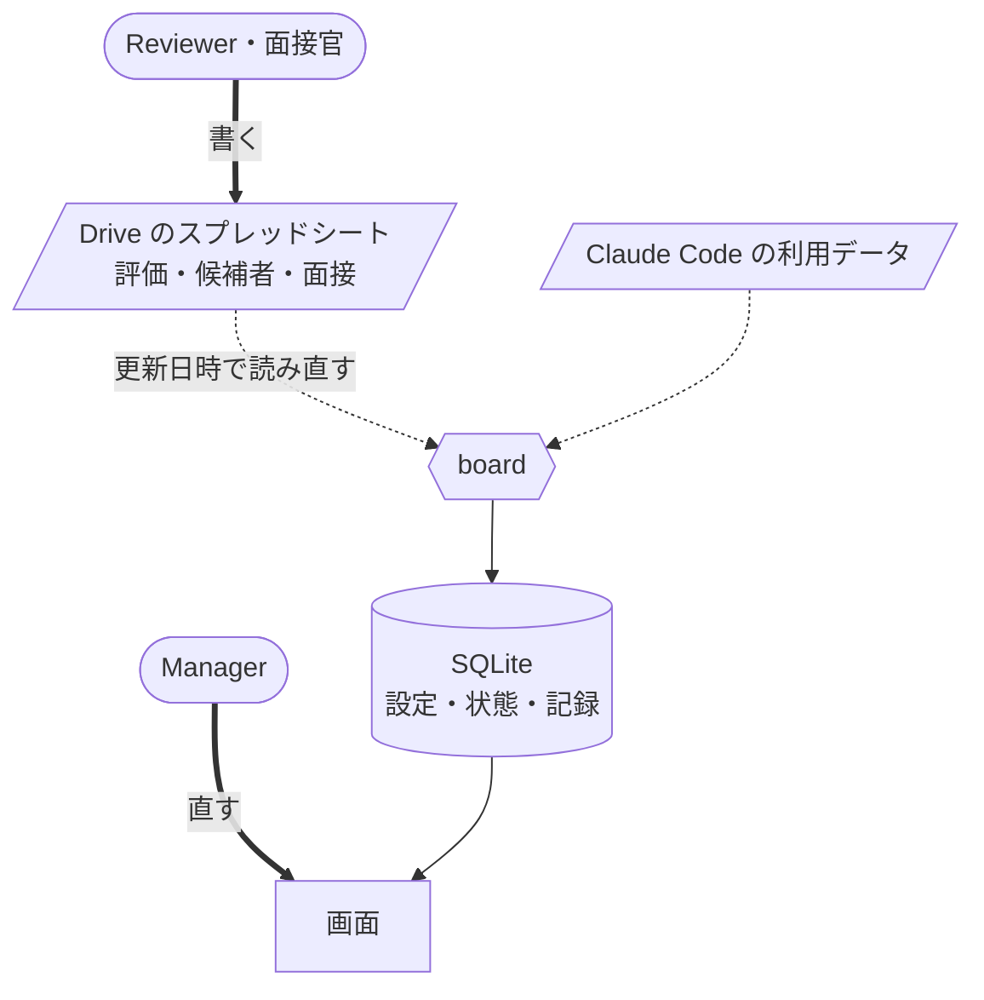

[🇯🇵 日本語](README.md) | [🇬🇧 English](README.en.md)

# mgmt-kit

[](https://github.com/yktsnet/mgmt-kit/actions/workflows/board.yml)

AI エージェントと開発するチームで、採用・育成・評価を1つの評価基準（5軸5段階の ladder）で回すウェブアプリ board。
評価する担当はスプレッドシートに判定と根拠を書くだけでよく、段階を決めて役割ごとに見せ分けるのは board が受け持つ。

## Screens

| | |
|---|---|
| **評価**<br> | **現在地**<br> |
| 細目ごとの判定と根拠から、軸の段階と本人の段階を決める。Reviewer が Submit し、Manager が Approve する。B の細目には、Claude Code の利用データにあるスキルの回数を添える | 評価と評価のあいだに、一人ずつの次に上げる1軸を決める。Claude Code の利用状況を、全員の平均と並べて見る |
| **採用**<br> | **設定**<br> |
| 在籍者と同じ細目を面接で判定し、採用枠の求める高さに届いていない軸を赤で出す。選考の段階はここで進める | 5×5 の定義の細目と版、在籍者の Reviewer と役割、採用枠を決める。評価か面接が使った版は直せず、New version を作る |

## Why

AI エージェントと開発するようになると、人の差は、配られた型を回せているかと、AI をどう使っているかにも出る。ところが成果物の形が人ごとに違うと、差が中身の差なのか書式の差なのかを読み分けられない。採用・育成・評価を別々の制度で回すと、制度ごとに尺度が違い、制度の間の食い違いを人が調整し続けることになる。

そこで mgmt-kit は、3つを1つの評価基準で判断する。判断の材料にするのは、配った型を回すと出てくる標準化された成果物と、型を回した記録である。

- **軸を決める。** 何を測るかが決まると、標準化が何を揃えるべきかも決まる
- **型を配る。** 標準化された手順をチームで回すと、成果物の形が揃う
- **成果物が見える。** 揃った成果物は、書式の差ではなく中身の差として読める
- **評価ができる。** 読めるものがあって初めて、人がどの段階にいるかを判定できる
- **既存人材と候補者を同じ尺度で測れる。** 軸は共通で、替えるのは評価の材料だけになる

この5つが繋がっていることに意味がある。評価軸だけを作ると、測る材料が出てこない。標準化だけをやると、回っているかどうかを誰も判定できない。採用だけ別の基準で回した場合は、入れた人を育てる段になって尺度が合わない。

軸は型より先に決める。標準化を先にやると、揃えるものが「書式」で止まる。判定文と型の置き場は1対1で対応させ、型に無い置き場を判定文が指していたら、どちらかを直す。型を配る側は [sdlc-kit](https://github.com/yktsnet/sdlc-kit) が受け持つ。

評価する人に新しい道具を覚えさせない。非エンジニアは使い慣れたスプレッドシートに書き、つなぐのはエンジニアリングの側という分け方である。

## Quick Start

```bash
git clone https://github.com/yktsnet/mgmt-kit.git
cd mgmt-kit/board
docker compose up
```

http://localhost:8000 を開く。何も設定しなければ、`board/samples/` の架空の10人と候補者を読むデモで起動し、ログインの画面で在籍者を選んで入る。設定・評価の状態・記録は volume に置くので、`docker compose down` と `up` のあとも残る。

本物の Google のアカウントでログインし、Drive のシートを読むまでの手順は [board/docs/setup.md](board/docs/setup.md) にある。

## How it works



シートは人が書く入力で、board は写しとして読む。定義と版、在籍者と役割、採用枠、評価と選考の状態と記録は board の SQLite だけが持ち、シートと二重に持たない。シートの形は [board/docs/sheets.md](board/docs/sheets.md) にある。

### Inputs

| 入力 | board での使い方 | 置き場 |
|---|---|---|
| ladder | 5軸5段階と各セルの判定文。board の定義の初版になり、運用しながら board の設定で直していく | `ladder/` |
| usage | Claude Code の利用データ。B 軸（配られた型の運用）の細目にスキルの回数を添え、現在地に利用状況を出す | `usage/` |

usage が評価に足すのは3つの観点である。標準化はスキルの回数と名前で、作業の量は Issue・PR・commit・行数で数える。投入の量はまず絶対数を見て、足りていれば使い方の効率を見る。3つがそろった状態と、そろわない場合ごとの対処は [あるべき姿](usage/tools/usage/claude-code/README.md#あるべき姿) にある。

### Roles

| 役割 | 見えるタブ | 見える範囲 |
|---|---|---|
| Manager | 評価・現在地・採用・設定 | すべて。評価を Approve できる |
| Reviewer（担当を持つ Member） | 評価・現在地 | 担当する人の評価と記録。自分の評価は Approved になったものだけ |
| Hiring を付けた Member | 現在地・採用 | 採用のすべて |
| Member | 現在地 | 自分の行と、全員の平均 |

役割は重なる。見せる範囲の決まりと理由は [board/docs/decisions.md](board/docs/decisions.md) の「見せる範囲」にある。

## Without board

board を使わずに、評価基準と集計だけを持ち込むこともできる。

**採点の skill**: 採点する相手の成果物があるリポジトリへ、`docs/` ごとコピーして使う。採点結果は5軸の点・段階・次に上げる1軸で、既定でファイルに書かない。置き場と実名の扱いは、残すと決めた側が先に決める。

```bash
git clone https://github.com/yktsnet/mgmt-kit.git
cp mgmt-kit/ladder/docs/{ladder,scoring,hiring,adapt}.md ~/repos/target/docs/
cp -r mgmt-kit/ladder/.claude/skills/ladder-score ~/repos/target/.claude/skills/
```

**利用状況の集計**: Claude Code の利用データをメンバー別に毎日並べ、組織の GitHub Actions の分数も数える。`usage/` は取り込み先の配置を写した形なので、管理用のリポジトリへコピーし、サンプルのデータと名簿を消す。

```bash
cp -R mgmt-kit/usage/. <管理用のリポジトリ>/
cd <管理用のリポジトリ>/tools/usage
rm -rf claude-code/{data,members,charts} github-actions/{data,charts} claude-code/github.json
```

そのあとはコピーした [tools/usage/README.md](usage/tools/usage/README.md) の「導入の手順」に従い、「組織に合わせて替える値」を直す。

## Scope

- usage は GitHub で Issue と PR を中心に仕事を進め、Claude Code を使うチームを前提にする。GitLab や別のエージェントで進めた仕事は評価できない
- 候補者には利用データが無いので、usage は在籍者にだけ当てる
- サンプルの人・リポ・データはすべて架空である。usage のダミーデータは `scripts/sample-usage.py` が作り、続けて各集計の `render.py` で表とグラフを作り直す

## Docs

| 文書 | 中身 |
|---|---|
| [ladder/docs/ladder.md](ladder/docs/ladder.md) | 5軸5段階と各セルの判定文、判定の材料にするもの。正本の分け方は ladder/README.md にある |
| [ladder/docs/personas.md](ladder/docs/personas.md) | 各段階の参照ペルソナ |
| [ladder/docs/scoring.md](ladder/docs/scoring.md) | 在籍者を採点し、次に上げる軸を決める手順 |
| [ladder/docs/hiring.md](ladder/docs/hiring.md) | 同じ軸を候補者に当てる手順 |
| [ladder/docs/adapt.md](ladder/docs/adapt.md) | 自社へ持ち込むときの差し替え方 |
| [ladder/docs/ref/sources.md](ladder/docs/ref/sources.md) | 下敷きにした公開ラダーとライセンス |
| [ladder/README.md](ladder/README.md) | 評価基準の全体を図でつかむスライド |
| [board/README.md](board/README.md) | board を直す人向けの入口 |
| [training/README.md](training/README.md) | 客先常駐の社員向けAI勉強会の提案資料 |

## License

MIT
