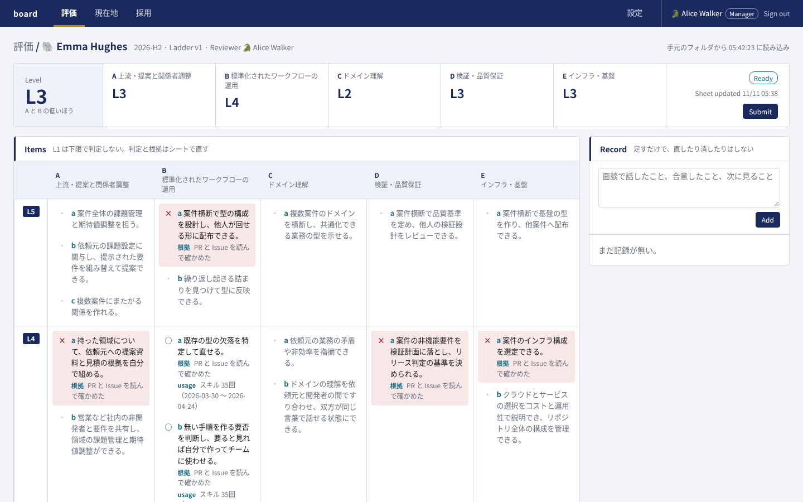
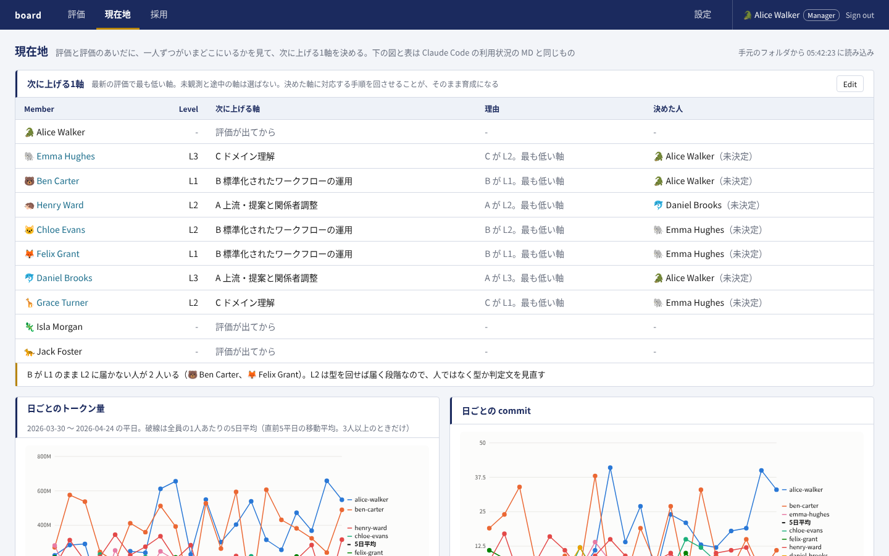
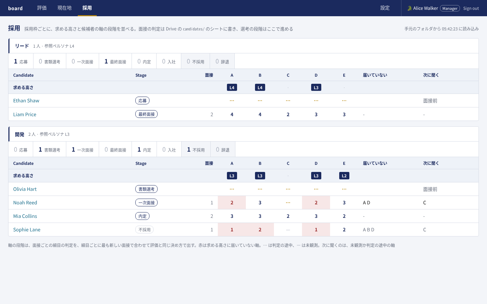
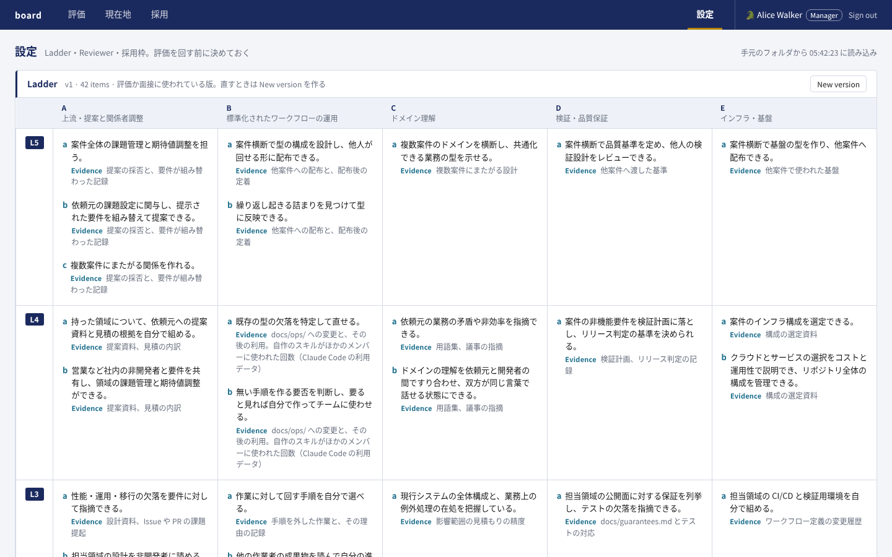
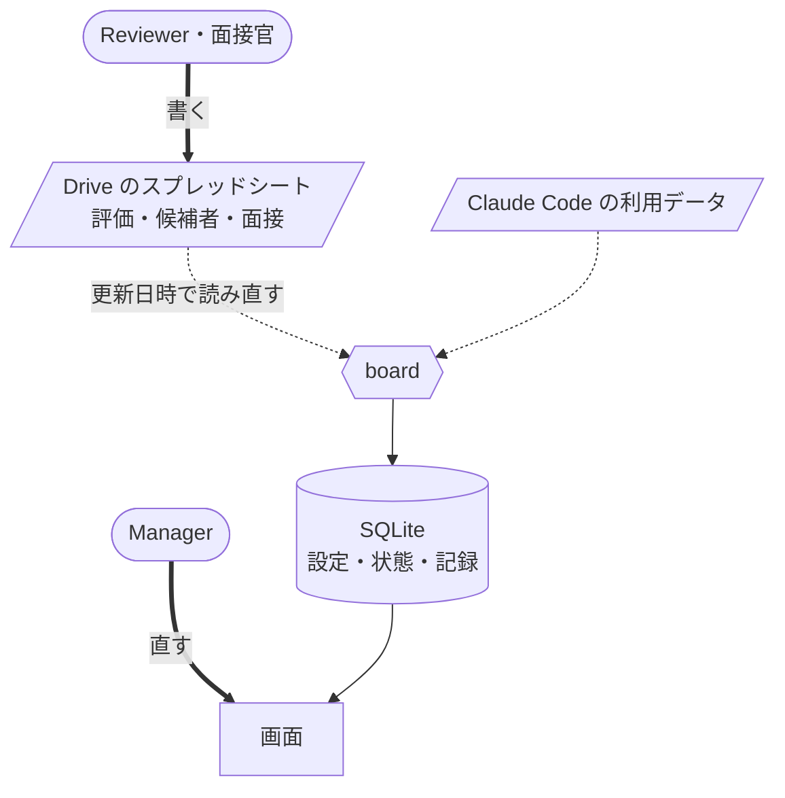

# board

ladder の5軸で、評価・育成・採用を1つのウェブアプリで回す。評価する担当とマネジメントは、使い慣れたスプレッドシートに判定と根拠を書くだけでよい。シートを読み、段階を決め、役割ごとに見せる範囲を絞って並べるのは board の側が受け持つ。非エンジニアはシートを書き、つなぐのはエンジニアリングの側という分け方である。

## 画面

| | |
|---|---|
| **評価**<br> | **現在地**<br> |
| 細目ごとの判定と根拠から、軸の段階と本人の段階を決める。Reviewer が Submit し、Manager が Approve する。B の細目には、Claude Code の利用データにあるスキルの回数を添える | 評価と評価のあいだに、一人ずつの次に上げる1軸を決める。Claude Code の利用状況を、全員の平均と並べて見る |
| **採用**<br> | **設定**<br> |
| 在籍者と同じ細目を面接で判定し、採用枠の求める高さに届いていない軸を赤で出す。選考の段階はここで進める | 5×5 の定義の細目と版、在籍者の Reviewer と役割、採用枠を決める。評価か面接が使った版は直せず、New version を作る |

## 役割ごとに見えるもの

| 役割 | 見えるタブ | 見える範囲 |
|---|---|---|
| Manager | 評価・現在地・採用・設定 | すべて。評価を Approve できる |
| Reviewer（担当を持つ Member） | 評価・現在地 | 担当する人の評価と記録。自分の評価は Approved になったものだけ |
| Hiring を付けた Member | 現在地・採用 | 採用のすべて |
| Member | 現在地 | 自分の行と、全員の平均 |

役割は重なる。Reviewer で Hiring を付けた人には、評価・現在地・採用が出る。見せる範囲の決まりと理由は [docs/decisions.md](docs/decisions.md) の「見せる範囲」にある。

## データの置き場



| 置き場 | 持つもの |
|---|---|
| Drive のスプレッドシート | 評価の判定と根拠、候補者、面接の判定と所見 |
| board の SQLite | 定義と版、在籍者と Reviewer と役割、採用枠、評価の状態（Draft → Submitted → Approved）と記録、選考の段階と記録、次に上げる軸 |

シートは人が書く入力で、board は写しとして読む。評価の前提になる値はシートと二重に持たないよう、board だけが持つ。シートの形は [docs/sheets.md](docs/sheets.md) にあり、テンプレートは `templates/` にある。

## 動かす

```bash
cd board
docker compose up
```

http://localhost:8000 を開く。何も設定しなければ、`samples/` の架空の10人と候補者を読むデモで起動し、ログインの画面で在籍者を選んで入る。設定・評価の状態・記録は volume に置くので、`docker compose down` と `up` のあとも残る。

Docker を使わないときは、Python 3.12 で venv に入れて起動する。

```bash
cd board
python -m venv .venv && .venv/bin/pip install -r requirements.txt -r requirements-dev.txt
.venv/bin/python -m pytest -q
.venv/bin/uvicorn app.main:create_app --factory --port 8000
```

本物の Google のアカウントでログインし、Drive のシートを読むまでの手順は [docs/setup.md](docs/setup.md) にある。

## 直す

board を直すときは、どこに何があり何を守るかを [docs/internals.md](docs/internals.md) で読む。
