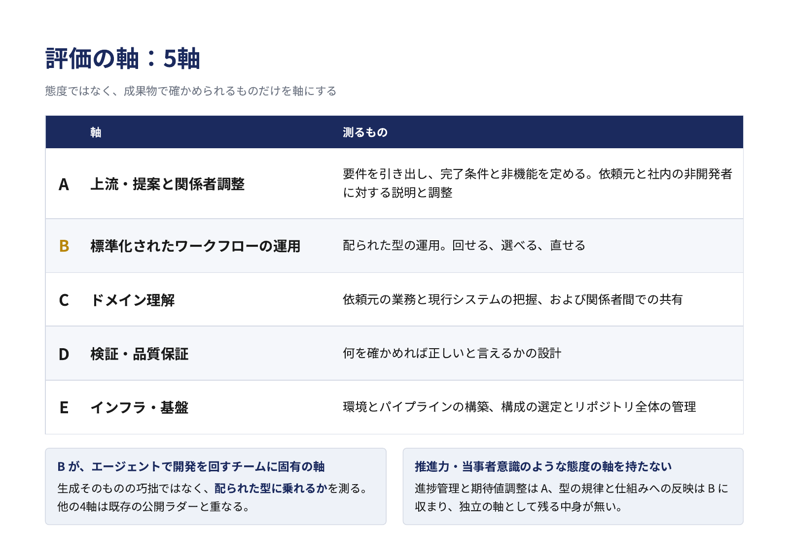
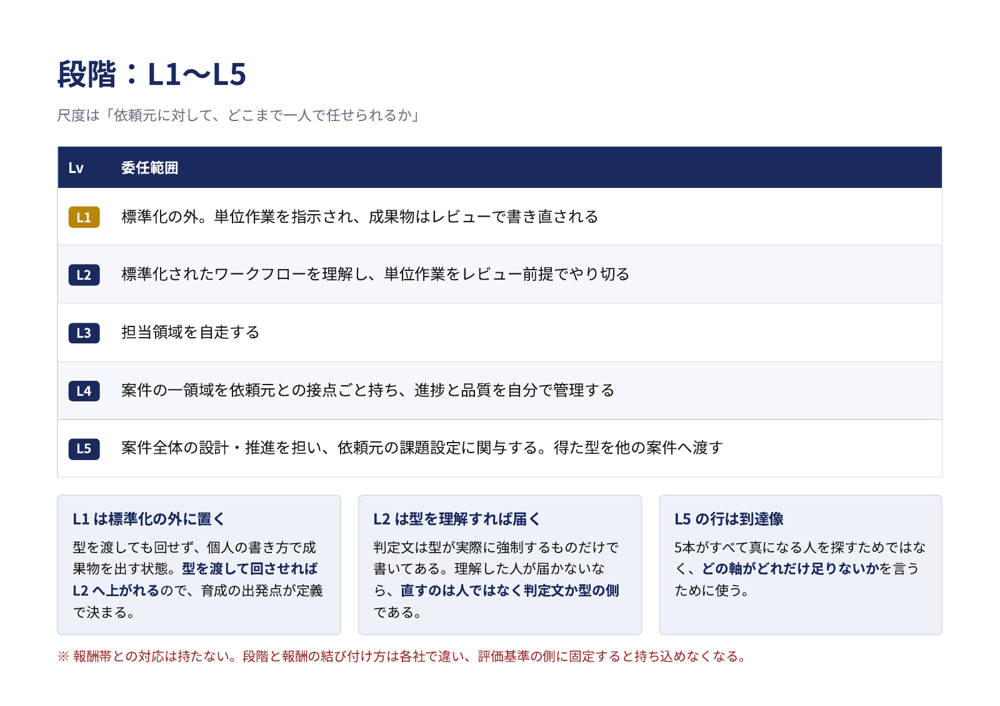
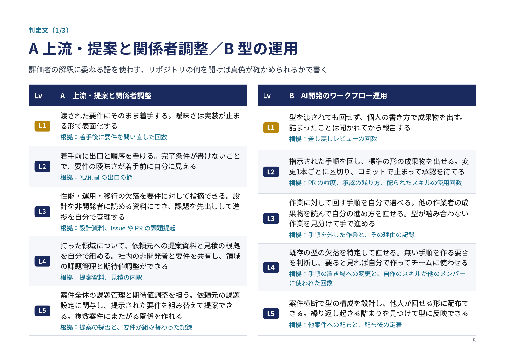
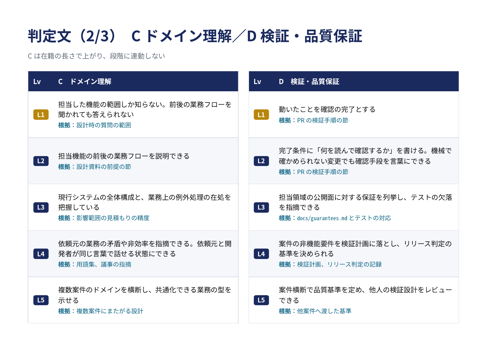
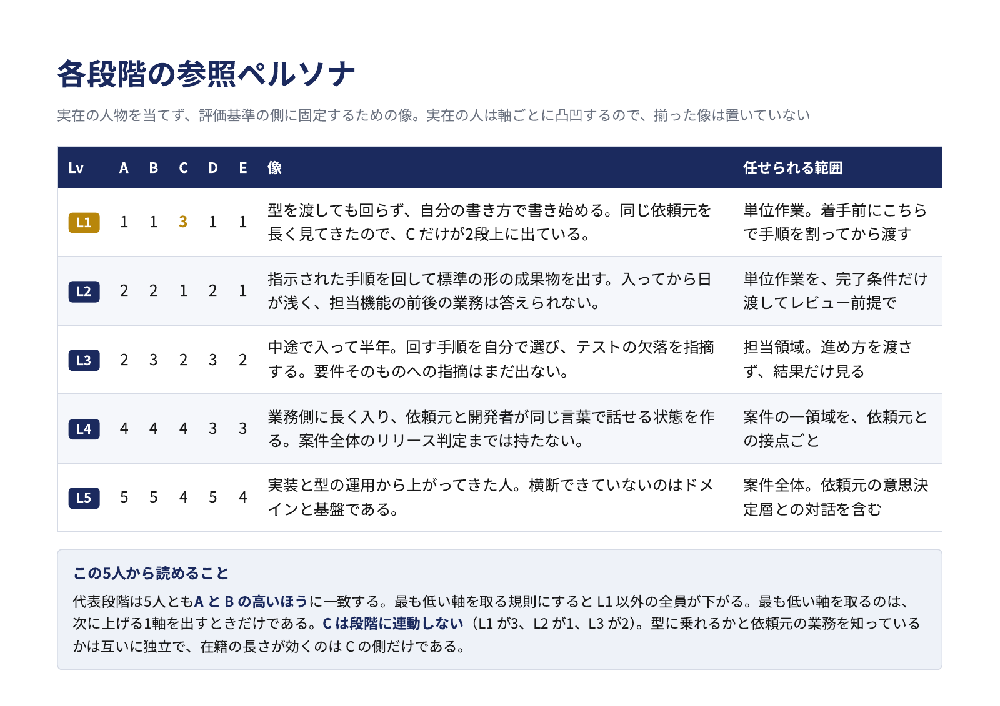

# 評価基準の説明スライド

エンジニアの何を測り、どの段階を何で判定し、採用・育成・評価にどう使うか。この評価基準の全体を、文書を読む前に図でつかむためのスライドである。正本は [docs/ladder.md](docs/ladder.md) で、スライドはそこから軸・段階・判定文・参照ペルソナを抜き出している。ずれたら ladder.md を正とする。

スライドの元は [slides.html](slides.html) で、PNG は `scripts/render-slides.sh ladder` で作り直す。

